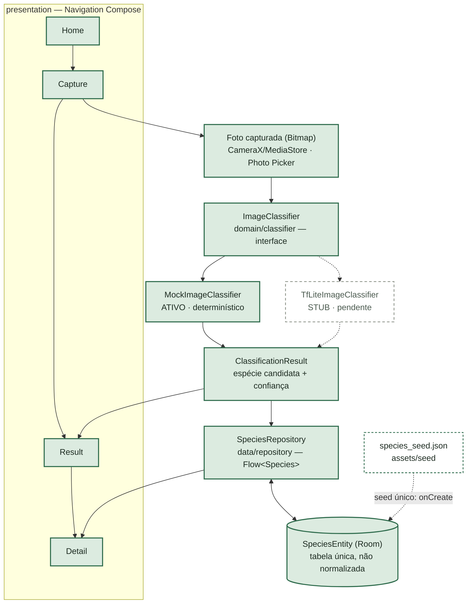

# BioScanner

## 📲 Baixar o app (Android)

**[⬇️ Baixar BioScanner.apk (versão mais recente)](https://github.com/VitorMorilho/Bio-Scanner/releases/latest/download/BioScanner.apk)**

Versão de teste. No celular, abra o arquivo baixado e, se pedir, permita "instalar apps
desconhecidos". O app avisa sozinho quando sai uma versão nova. Histórico de versões em
[Releases](https://github.com/VitorMorilho/Bio-Scanner/releases).

Feito por Vitor Morilho · [veja outros projetos no meu portfólio](https://vitormorilho.github.io/#bioscanner).

---

App Android (Kotlin + Jetpack Compose) que identifica espécies de animais/plantas a partir de
uma foto: o usuário tira/seleciona a foto, um modelo TensorFlow Lite on-device classifica a
espécie, e o app busca a descrição completa no banco Room local.

> **Aviso de segurança:** a identificação automática é uma sugestão, não substitui avaliação
> médica/especializada — especialmente relevante em casos de suspeita de picada de cobra.

**Status atual:** esqueleto MVP funcionando ponta a ponta (Home → Capture → Result → Detail)
com **dados mock** — sem dataset real de imagens nem modelo `.tflite` treinado ainda.

## Fluxo do projeto: o que foi feito e o que foi usado

A interface `ImageClassifier` hoje resolve, via Koin (`classifierModule` em `di/AppModules.kt`), para
`MockImageClassifier` — dados determinísticos derivados de propriedades baratas do `Bitmap`,
escolhendo entre as espécies realmente seedadas no Room. Trocar para o modelo real depois de
treinado é mudar **um parâmetro** nesse módulo, sem tocar em mais nada. Toda a UI lê os dados
através do `SpeciesRepository`, que expõe a tabela Room como `Flow`; essa tabela é populada uma
única vez, na criação do banco, a partir de `species_seed.json`.

### O que foi usado

| Área | Tecnologias |
|---|---|
| Linguagem & UI | Kotlin 2.0.21, Jetpack Compose, Navigation Compose |
| Arquitetura & DI | MVVM + Clean Architecture, Koin 4.2.2, Coroutines + Flow |
| Dados locais | Room, kotlinx.serialization, seed JSON (`assets/seed`) |
| Câmera & mídia | CameraX, MediaStore (`Pictures/BioScanner`), Photo Picker |
| ML (preparado, não plugado) | `tensorflow-lite` (core) — `tensorflow-lite-support` propositalmente excluído (bug de packaging com AGP 9) |
| Build | AGP 9.1.1, KSP 2.3.12, compileSdk/targetSdk 36, minSdk 24, Java 11 |

### Feito vs. pendente

**Feito (MVP com dados mock)**
- Fluxo completo Home → Capture → Result → Detail navegável
- ~6 espécies de cobra seedadas de `species_seed.json`
- `MockImageClassifier` determinístico plugado via Koin
- Room (`SpeciesEntity`) com seed único no `onCreate`
- Disclaimer de segurança visível em todas as telas relevantes

**Pendente**
- Dataset real de imagens (aguardando o usuário indicar o caminho)
- Modelo `.tflite` treinado + `labels.txt`
- Trocar no `classifierModule` o `MockImageClassifier` → `TfLiteImageClassifier`
- Fotos de referência em `assets/images/reference/`
- Identidade de autor git configurada e primeiro commit
